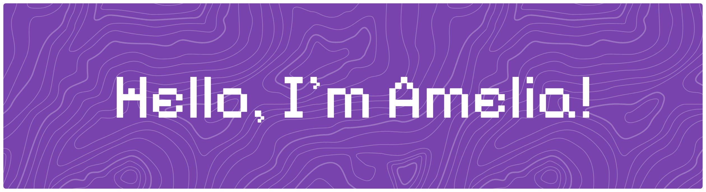

## I'm a Software Engineering (RPL) student at SMK Negeri 1 Surabaya, building my foundation in programming, software development, and computer science.

## I'm particularly interested in **cybersecurity**, especially web security and CTF challenges, while also exploring machine learning and neural networks.
_______________________________________________
## Technologies I'm Exploring

                           

_______________________________________________

### GitHub Stats >>>>
 
 

